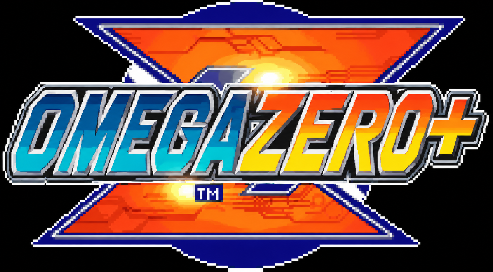

<h1 align="center"></h1>

A Game Boy-centric frontend for Anbernic H700 handhelds running
<a href="https://github.com/pvaibhav/BaseOS">BaseOS</a>. It plays GBA, GBC and GB games, and Genesis,
32X, Sega CD, SNES and PlayStation games too, on a shelf of cartridges and discs that go down into the handheld when
you play them.

<a href="https://oauramos.github.io/omega-zero/"><b>Site</b></a> ·
<a href="https://github.com/oauramos/omega-zero/releases/latest"><b>Download</b></a> ·
<a href="https://github.com/oauramos/omega-zero/wiki"><b>Wiki</b></a> ·
<a href="CHANGELOG.md"><b>Changelog</b></a>

## Supported devices

One build runs on all of them: omega-zero reads the model from BaseOS at boot and lays itself out
for its panel.

| Device | Panel | Status |
|---|---|---|
| RG35XX SP | 640x480 | Main target, in daily use |
| RG SP | 720x480 | Supported, not yet retested on hardware |
| RG34XX SP, RG34XX | 720x480 | Untested |
| RG35XX Plus / 2024, H, Pro | 640x480 | Untested |
| RG40XX H, RG40XX V | 640x480 | Untested |
| RG CubeXX | 720x720 | Experimental |
| RG28XX | 480x640, turned | Experimental |

Own an untested one? A [device report](https://github.com/oauramos/omega-zero/wiki/Device-Reports)
is the most useful thing you can send.

## Highlights

- A shelf for each system, modelled low-poly and drawn the way a PlayStation drew 3D, with real
  label scans: Game Boy carts in their own plastics, NES and SNES carts in their American shape
  for a game from the USA and the Famicom shape for the rest, and PlayStation discs, a game on several
  discs standing as a stack of them. The one you are on floats and sways; A pulls it down out of
  the screen into the handheld, and the game comes on like a tube TV. At power-on, an opening in the
  style of Mega Man X5's boot terminal tells you the handheld's memory, chip and battery, then
  fades into the shelf.
- Seven cores: mGBA and gpSP for the GBA, Mesen for NES/Famicom, PicoDrive for Genesis, 32X and Sega CD, and Snes9x and Supafaust for the SNES, chosen per cart;
  mGBA for the Game Boys; PCSX ReARMed for the PlayStation, with a BIOS of its own built in. GBA
  fills a 640x480 screen and the PlayStation fills it at 4:3; the SNES is drawn at twice its size,
  and Game Boy stays at 3x.
- A PlayStation game on several discs is one game: DISC, on SELECT+MENU in a game, puts another
  disc in, and the game resumes with the disc that was in the drive.
- Resume on boot, save states with a switcher, rewind (not on the PlayStation), fast-forward,
  and turbo buttons on the Game Boys.
- Link play between two handhelds over Wi-Fi, for Game Boy and GBA games: Pokémon trades,
  Advance Wars, Mario Kart and Tetris.
- Settings on START, in windows in the style of Mega Man Zero's menus that slide from screen to
  screen, over a background that keeps moving: CONFIGS (Fast Forward, Fast Forward Sound, Colour
  Correction, Rumble, Labels) and GENERAL (Date & Time, Network, Bluetooth, Theme, About).
- A tap of SELECT opens CONTROLS: what every button does, on the shelf and in a game, on one panel.
- Network: home Wi-Fi, network time, and SSH and SFTP, each ON or OFF. Y on one opens its panel:
  SSH's shows the login and root's own random password. Labels are fetched from ScreenScraper,
  one for each disc of a PlayStation game.
- Bluetooth, on handhelds that have it: pair a device and connect it, or forget it. Game sound and
  gamepads over Bluetooth are still to come.
- Theme: the background's pattern, its motion and its colour, which the menus and both bars take
  (Night is grey, Amber is Mega Man Zero's own), and the bottom bar's font, Bold or Thin.
- A pixel font, a top bar with the radios, clock and battery, and a bottom bar with the buttons.

## Screens

 The RG35XX SP in 3D, drawn the way a PlayStation drew it, with omega-zero's own screens on it: the loops play on the <a href="https://oauramos.github.io/omega-zero/">site</a>

 Settings, in Night and in Amber

 Network and Bluetooth

 Theme, and CONTROLS on a tap of SELECT

## Quick start

1. Write the [BaseOS image](https://github.com/pvaibhav/BaseOS/releases/latest) for your model to a
   microSD card, put it in **SD1** and boot once.
2. Copy the contents of the [latest release](https://github.com/oauramos/omega-zero/releases/latest)
   to the root of that card.
3. Put your games in `Games/GBA`, `Games/GB`, `Games/GBC`, `Games/GENESIS`, `Games/32X`,
   `Games/SEGACD`, `Games/NES`, `Games/SNES` and `Games/PS1`. NES accepts `.nes`, `.unf` and
   `.unif`; Genesis accepts `.md`, `.gen`, `.smd` and
   `.bin`; 32X accepts `.32x` and `.bin`; Sega CD accepts `.cue`, `.chd` and `.m3u`. Put the
   matching Sega CD BIOS files in `BIOS/` as `bios_CD_U.bin`, `bios_CD_E.bin` and
   `bios_CD_J.bin` for USA, Europe and Japan respectively. A
   PlayStation game is a `.cue` with its `.bin`, a `.chd`, a `.pbp` or an `.m3u`; a real
   PlayStation BIOS, such as `scph5501.bin`, is used from `BIOS/` when it is there.
4. Boot. On the shelf, START opens Settings and a tap of SELECT shows every button.

Two cards and updating are in the site's
[install guide](https://oauramos.github.io/omega-zero/#install); controls and everything else are
in the [wiki](https://github.com/oauramos/omega-zero/wiki).

## Extended platform enhancement

> This section documents the extended workspace build. It is an enhancement over the original
> omega-zero project; the original description, installation notes, credits and licence remain
> intact above and below. Platform presence means the frontend, folders, visual model and launch
> path are integrated. Hardware compatibility can still vary by game, core and H700 model.

The enhancement keeps the cartridge-and-disc presentation and adds dedicated monochrome models
for the new physical media. On first start, omega-zero creates the matching directory under
`Games/` (and matching `Labels/`, `Overlays/`, `Saves/` and `States/` directories).

### Integrated platforms

| Platform | Games directory | Core / runtime | Accepted content |
|---|---|---|---|
| Game Boy Advance | `GBA` | mGBA / gpSP | `.gba` |
| Game Boy / Game Boy Color | `GB`, `GBC` | mGBA | `.gb`, `.gbc` |
| Game Gear / Master System / SG-1000 | `GAMEGEAR`, `MASTERSYSTEM`, `SG1000` | PicoDrive | `.gg`; `.sms`; `.sg`, `.sc`, `.sgd` |
| Genesis / Mega Drive | `GENESIS` | PicoDrive | `.md`, `.gen`, `.smd`, `.bin` |
| Sega 32X | `32X` | PicoDrive | `.32x`, `.bin` |
| Sega CD | `SEGACD` | PicoDrive | `.cue`, `.chd`, `.m3u` |
| NES / Famicom | `NES` | Mesen | `.nes`, `.unf`, `.unif` |
| Famicom Disk System | `FDS` | Mesen | `.fds` |
| SNES / Super Famicom | `SNES` | Snes9x / Supafaust | `.sfc`, `.smc` |
| SuFami Turbo | `SUFAMITURBO` | Snes9x | `.st`, `.fig`, `.smc`, `.sfc` |
| Atari 2600 | `ATARI2600` | Stella 2023 | `.a26`, `.bin` |
| Atari 800 | `ATARI800` | Atari800 | `.xfd`, `.atr`, `.dcm`, `.cas`, `.bin`, `.zip`, `.atx`, `.car`, `.rom`, `.com`, `.xex`, `.m3u` |
| Atari 5200 | `ATARI5200` | Atari800 | `.a52`, `.bin` |
| Atari 7800 | `ATARI7800` | ProSystem | `.a78`, `.bin`, `.cdf` |
| Atari Lynx | `LYNX` | Handy | `.lnx`, `.lyx`, `.o` |
| Atari Jaguar / Jaguar CD | `JAGUAR`, `JAGUARCD` | BigPEmu | `.j64`, `.jag`, `.rom`, `.abs`, `.cof`, `.bin`, `.prg`; `.cue`, `.cdi`, `.chd` |
| Atari ST | `ATARIST` | Hatari | `.st`, `.msa`, `.zip`, `.stx`, `.dim`, `.ipf`, `.vhd`, `.gem`, `.ide`, `.m3u` |
| Vectrex | `VECTREX` | VecX | `.vec`, `.bin` |
| Virtual Boy | `VIRTUALBOY` | Beetle VB | `.vb`, `.vboy`, `.bin` |
| Pokémon Mini | `POKEMONMINI` | PokeMini | `.min` |
| Game & Watch | `GAMEANDWATCH` | gw-libretro | `.mgw` |
| Arduboy | `ARDUBOY` | Arduous | `.hex` |
| WonderSwan / WonderSwan Color | `WS`, `WSC` | Beetle WonderSwan | `.ws`, `.wsc` |
| Mega Duck | `MEGADUCK` | SameDuck | `.bin` |
| Watara Supervision | `SUPERVISION` | Potator | `.sv`, `.bin` |
| Neo Geo Pocket / Pocket Color | `NEOGEOPOCKET`, `NEOGEOPOCKETCOLOR` | Beetle NeoPop | `.ngp`; `.ngc`, `.ngpc`, `.npc` |
| Neo Geo AES / Neo Geo CD | `NEOGEO`, `NEOGEOCD` | FinalBurn Neo | `.zip`, `.7z`; `.cue`, `.ccd`, `.chd`, `.m3u` |
| CPS-1 / CPS-2 / CPS-3 / FBNeo | `CPS1`, `CPS2`, `CPS3`, `FBNEO` | FinalBurn Neo | `.zip`, `.7z` |
| MAME | `MAME` | MAME 2003-Plus | `.zip` |
| GP32 | `GP32` | GP32emu | `.smc`, `.fxe`, `.fpk`, `.zip`, `.7z` |
| PC Engine / TurboGrafx-16 | `TG16-PCE` | Beetle PCE Fast | `.pce` |
| PC Engine CD / TurboGrafx-CD | `TG16CD-PCECD` | Beetle PCE Fast | `.cue`, `.ccd`, `.chd`, `.toc`, `.m3u` |
| PC Engine SuperGrafx | `SUPERGRAFX` | Beetle SuperGrafx | `.sgx`, `.pce` |
| NEC PC-FX | `PCFX` | Beetle PC-FX | `.cue`, `.ccd`, `.toc`, `.chd` |
| NEC PC-8800 | `PC8800` | QUASI88 | `.d88`, `.m3u`, `.t88`, `.cmt` |
| NEC PC-9800 | `PC9800` | Neko Project II kai | disk and HDD images listed by the scanner, plus `.m3u` |
| Amiga CD32 | `CD32` | PUAE | `.cue`, `.ccd`, `.nrg`, `.mds`, `.iso`, `.chd`, `.m3u` |
| PlayStation | `PS1` | PCSX-ReARMed | `.cue`, `.chd`, `.pbp`, `.m3u` |
| TIC-80 / PICO-8 / CHIP-8 | `TIC80`, `PICO8`, `CHIP8` | TIC-80 / Retro8 / JAXE | `.tic`; `.p8`, `.png`; `.ch8`, `.c8`, `.sc8`, `.xo8` |
| Java ME | `JAVA` | SquirrelJME | `.jar`, `.jad` and supported Java ME package formats |
| Vircon32 / Uzebox | `VIRCON32`, `UZEM` | Vircon32 / Uzem | `.v32`; `.uze` |
| Daphne laserdisc | `DAPHNE` | Hypseus Singe | `.daphne` launch entries |

### H700 build profile

The repository keeps every platform integration above for future device profiles. The H700
release intentionally omits **Amiga CD32, GP32, NEC PC-8800, NEC PC-9800, NEC PC-FX, Atari
Jaguar, Atari Jaguar CD and Daphne** because their current cores/runtimes are unstable or too
slow on that SoC. Their source code, assets, build recipes and documentation remain in the
project.

`task dist:device` and the device deployment tasks build the `device,h700` frontend, create no
folders for those platforms, and do not package their exclusive cores. `task cores:device`
remains available to build the complete ARM64 core set for future hardware profiles.

### BIOS and firmware

Firmware is copyrighted and is not supplied unless its licence allows redistribution. Filenames
are case-sensitive. Put user-provided files under `BIOS/` exactly as shown.

| Platform | Requirement | File(s) |
|---|---|---|
| Sega CD | Required | One or more regional PicoDrive BIOS files, normally `bios_CD_U.bin`, `bios_CD_E.bin`, `bios_CD_J.bin` |
| Famicom Disk System | Required | `disksys.rom` (8 KiB) |
| SuFami Turbo | Required | `STBIOS.bin` (256 KiB) |
| Atari 5200 | Required | `5200.rom` (2 KiB) |
| Atari ST | Required | `tos.img` |
| PC Engine CD / TurboGrafx-CD | Required | `syscard3.pce` |
| PC-FX | Required | `pcfx.rom` (1 MiB) |
| Neo Geo AES | Required | `BIOS/fbneo/neogeo.zip` (root-level `BIOS/neogeo.zip` is also recognised) |
| Neo Geo CD | Required | `BIOS/fbneo/neogeo.zip` and `BIOS/fbneo/neocdz.zip` |
| Amiga CD32 | Required | `kick40060.CD32` (1 MiB), or `kick40060.CD32` plus `kick40060.CD32.ext` (512 KiB each) |
| NEC PC-9800 | Required | `BIOS/np2kai/bios.rom` and `BIOS/np2kai/font.rom` or `font.bmp` |
| NEC PC-8800 | Optional, recommended | `BIOS/quasi88/N88.ROM` and `N88SUB.ROM` or `DISK.ROM`; QUASI88 has a compatibility fallback |
| GP32 | Optional | `gp32166m.bin`; GP32emu uses the real firmware when present and falls back to HLE when absent |
| Game Boy Advance | Optional | `gba_bios.bin` (16 KiB); mGBA/gpSP can use built-in boot paths |
| PlayStation | Optional | A compatible BIOS such as `scph5501.bin`; PCSX-ReARMed can use its built-in HLE BIOS |

### Enhancement credits

The original omega-zero and slot credits remain the project foundation. Additional emulation in
this enhancement is provided by the respective upstream projects: [Stella 2023](https://github.com/libretro/stella2023),
[Atari800](https://github.com/libretro/libretro-atari800), [ProSystem](https://github.com/libretro/prosystem-libretro),
[Handy](https://github.com/libretro/libretro-handy), [Hatari](https://github.com/libretro/hatari),
[QUASI88](https://github.com/libretro/quasi88-libretro), [Neko Project II kai](https://github.com/libretro/NP2kai),
[Beetle VB](https://github.com/libretro/beetle-vb-libretro), [PokeMini](https://github.com/libretro/PokeMini),
[gw-libretro](https://github.com/libretro/gw-libretro), [Arduous](https://github.com/libretro/arduous),
[Beetle WonderSwan](https://github.com/libretro/beetle-wswan-libretro), [SameDuck](https://github.com/libretro/sameduck),
[Potator](https://github.com/libretro/potator), [Beetle NeoPop](https://github.com/libretro/beetle-ngp-libretro),
[Beetle PCE Fast](https://github.com/libretro/beetle-pce-fast-libretro),
[Beetle PC-FX](https://github.com/libretro/beetle-pcfx-libretro), [FinalBurn Neo](https://github.com/libretro/FBNeo),
[MAME 2003-Plus](https://github.com/libretro/mame2003-plus-libretro), [GP32emu](https://github.com/gameblabla/gp32emu),
[VecX](https://github.com/libretro/libretro-vecx), [PUAE](https://github.com/libretro/libretro-uae),
[TIC-80](https://github.com/libretro/TIC-80), [Retro8](https://github.com/libretro/retro8),
[SquirrelJME](https://github.com/SquirrelJME/SquirrelJME), [Vircon32](https://github.com/vircon32/vircon32-libretro),
[Uzem](https://github.com/libretro/libretro-uzem), [JAXE](https://github.com/kurtjd/jaxe),
[Hypseus Singe](https://github.com/DirtBagXon/hypseus-singe) and BigPEmu by Rich Whitehouse.

BigPEmu is proprietary and is not relicensed by this project. Its use and redistribution remain
subject to its own terms. Every open-source core built for the device ships with its pinned source
archive and build metadata under `System/licenses/`.

## Credits and licence

omega-zero is made by **Otávio ([@oauramos](https://github.com/oauramos))**.

- Based on [slot](https://github.com/BrandonKowalski/slot) by
  [Brandon T. Kowalski](https://github.com/BrandonKowalski) (GPL-3.0). The code that hosts the
  cores, with their saves, sound and input, is still largely his.
- [BaseOS](https://github.com/pvaibhav/BaseOS) by pvaibhav.
- Emulation by [mGBA](https://mgba.io) (MPL-2.0) and [gpSP](https://github.com/libretro/gpsp)
  (GPL-2.0) for the Game Boys; [Mesen](https://github.com/libretro/Mesen) (GPL-3.0) for NES and
  Famicom; [PicoDrive](https://github.com/notaz/picodrive) (free for
  non-commercial use only) for Genesis, 32X and Sega CD; [Snes9x](https://github.com/libretro/snes9x) (free for
  non-commercial use only) and [Supafaust](https://github.com/libretro/supafaust), Mednafen's
  snes_faust (GPL-2.0), for the SNES; and
  [PCSX ReARMed](https://github.com/libretro/pcsx_rearmed) (GPL-2.0) for the PlayStation. Their
  licences and patches, and the source of all but mGBA, ship in `System/licenses/`.
- Type is [Pixel Code](https://github.com/qwerasd205/PixelCode) by Qwerasd (SIL OFL 1.1); every
  icon is drawn as pixel art. The LCD mask is derived from GigaHerz's LCD3x.
- Cart labels come from [ScreenScraper](https://www.screenscraper.fr), fetched with your own
  account.

omega-zero is licensed under the GPL-3.0-or-later; see [LICENSE](LICENSE). It began in October
2026 as a modified version of slot. It is written with Claude, and reviewed and tested by its
maintainer. The site and these pictures are drawn with its
UI kit, [`assets/ui`](assets/ui).

Game Boy, Game Boy Color, Game Boy Advance, Super Nintendo Entertainment System and Super Famicom
are trademarks of Nintendo. Genesis, 32X and Sega CD are trademarks of Sega. PlayStation is a trademark of Sony Interactive Entertainment. Anbernic
is a trademark of its owner. This project is not affiliated with any of them.
